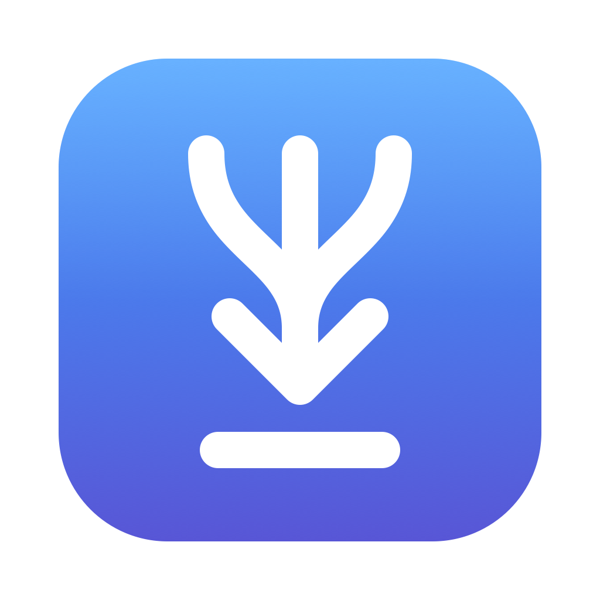
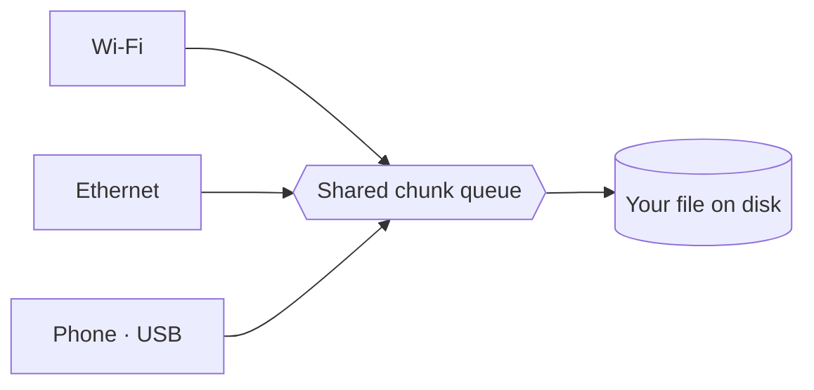

<div align="center">



# NetSetGo

**Every network you have. One download.**

NetSetGo is a free, open-source download manager for macOS, Windows and Linux.<br>
It splits a single download across Wi-Fi, Ethernet and your phone's hotspot — all at once.

<br>

[**Download**](https://netsetgo.dhirajlochib.com) &nbsp;·&nbsp;
[Features](#-features) &nbsp;·&nbsp;
[How it works](#-how-it-works) &nbsp;·&nbsp;
[FAQ](#-faq) &nbsp;·&nbsp;
[Build](#-build-from-source) &nbsp;·&nbsp;
[Roadmap](ROADMAP.md)

<br>

[](https://github.com/dhirajlochib/net-set-go/releases/latest)
[](https://github.com/dhirajlochib/net-set-go/actions/workflows/ci.yml)
[](https://netsetgo.dhirajlochib.com/#downloads)
[](LICENSE)

</div>

<br>

## ✦ Why NetSetGo

Your laptop is often connected to more than one network — home Wi-Fi, an Ethernet cable, a phone over USB — but a normal download only ever uses one of them.

NetSetGo uses them **together**.

|                      | Browser / single connection | NetSetGo                         |
| -------------------- | --------------------------- | -------------------------------- |
| Networks used        | 1                           | All you pick                     |
| Parallel streams     | 1–6                         | Up to 32 per network, auto-tuned |
| Resume after restart | Sometimes                   | Yes                              |
| Torrents & magnets   | No                          | Built in                         |
| Speed & data limits  | No                          | Per network, with schedules      |
| VPN or driver needed | —                           | None                             |

<br>

## ✦ Features

<table>
<tr>
<td width="50%" valign="top">

#### ⚡ Multi-network speed

- Combine Wi-Fi, Ethernet and USB tethering
- Faster networks automatically take more of the file
- Streams auto-tune to network, server and disk
- Idle streams race slow chunks so the finish isn't slow
- Turn networks on or off mid-download

</td>
<td width="50%" valign="top">

#### 📥 Downloads that just work

- Direct links, magnet links and `.torrent` files
- Pick torrent files before or during a download
- Pause and resume, even across restarts
- Reconnects after sleep
- Swap in a fresh link without losing progress

</td>
</tr>
<tr>
<td valign="top">

#### 🧭 Browser extension

- Chrome, Edge and Firefox
- Hands downloads over with your sign-in cookies
- Send a single link or capture everything
- Skip small files or excluded sites

</td>
<td valign="top">

#### 🎛 You stay in control

- Global and per-network speed limits
- Daily, weekly or monthly data allowances
- Slow mode for calls and streaming
- Schedule downloads by time and day
- Queue, bulk pause, resume, retry and remove

</td>
</tr>
</table>

<br>

## ✦ How it works



1. **Split.** For direct links NetSetGo asks the server for byte ranges and puts the chunks in a shared queue.
2. **Spread.** Each selected network runs its own streams, pulling the next chunk as soon as it finishes one — so the fastest network naturally does the most work.
3. **Finish fast.** Near the end, idle streams race the slowest chunks; whichever lands first wins.
4. **Assemble.** Chunks are written straight into place on disk. No temp files to merge.

Torrents work the same way at the peer level: each new peer connects through whichever selected network has the fewest.

> [!NOTE]
> A second network only adds speed if it reaches the internet on its **own** connection. Wi-Fi + phone hotspot: yes. Wi-Fi + Ethernet on the same router: no — they share one line.

<br>

## ✦ Install

Grab the latest build from the [website](https://netsetgo.dhirajlochib.com) or [GitHub Releases](https://github.com/dhirajlochib/net-set-go/releases/latest).

| Platform    | File                                                      | First launch                                                                               |
| ----------- | --------------------------------------------------------- | ------------------------------------------------------------------------------------------ |
| **macOS**   | `.dmg` — Apple silicon or Intel                           | Not notarized yet. Open once, then **System Settings → Privacy & Security → Open Anyway**. |
| **Windows** | `-setup.exe` — x64 and ARM64 in one                       | Not signed yet. On _Windows protected your PC_ click **More info → Run anyway**.           |
| **Linux**   | `.AppImage` · `.deb` · `.rpm` · `.tar.gz` — x64 and ARM64 | `chmod +x` the AppImage, or install the package. Multiple networks need kernel 5.7+.       |

<details>
<summary>macOS says the app is “damaged”</summary>
<br>

That's Gatekeeper reacting to an unsigned download. Clear the flag once:

```bash
xattr -dr com.apple.quarantine /Applications/NetSetGo.app
```

</details>

<br>

## ✦ FAQ

<details>
<summary><b>A second network doesn't make downloads faster</b></summary>
<br>

Each network needs its own route to the internet. Two adapters on the same router share one connection, so the total doesn't grow. VPN, virtual and isolated adapters show up too — check each one's latency and speed in the app.

</details>

<details>
<summary><b>My phone doesn't appear as a network</b></summary>
<br>

NetSetGo uses anything your OS shows as a network adapter.

- **iPhone on macOS** — _System Settings › Network › iPhone USB_, turn off **Disable unless needed**.
- **Android on macOS** — macOS has no RNDIS driver. Install [TetherKit](https://github.com/XiaoMiku01/TetherKit) (`brew install XiaoMiku01/tap/tetherkit`), turn on USB tethering on the phone, then connect in TetherKit.
- **Any phone on Windows** — install the phone maker's USB driver.

</details>

<details>
<summary><b>Windows only uses one network</b></summary>
<br>

If Windows drops Wi-Fi when Ethernet is plugged in, open `gpedit.msc` → _Computer Configuration › Administrative Templates › Network › Windows Connection Manager_ and set **Minimize the number of simultaneous connections…** to **Disabled**.

</details>

<details>
<summary><b>A network stays idle after reconnecting my phone</b></summary>
<br>

Pause the download, then resume it.

</details>

<details>
<summary><b>Downloads to a hard drive are slow</b></summary>
<br>

Leave **Streams** on **Auto** in _New download_. Auto backs off when the disk can't keep up; a fixed number doesn't.

</details>

<br>

## ✦ Build from source

Requires **Node.js 22.13+** and **npm 9+**.

```bash
git clone https://github.com/dhirajlochib/net-set-go.git
cd net-set-go
npm ci
npm run dev
```

| Command                   | Does                                             |
| ------------------------- | ------------------------------------------------ |
| `npm run dev`             | Run the app with hot reload                      |
| `npm run typecheck`       | Type-check main, renderer, tests and extension   |
| `npm run test:e2e:smoke`  | Fast Playwright smoke tests                      |
| `npm run test:e2e`        | Full end-to-end suite                            |
| `npm run build:mac`       | macOS `.dmg` + `.zip` in `dist/`                 |
| `npm run build:win`       | Windows installer in `dist/`                     |
| `npm run build:linux`     | AppImage, `.deb`, `.rpm`, `.tar.gz` in `dist/`   |
| `npm run build:extension` | Chrome + Firefox extensions in `extension/dist/` |

Package each platform on that platform. See [CONTRIBUTING.md](CONTRIBUTING.md) for signing, the extension and tests.

<br>

## ✦ Tech

Electron · React 19 · TypeScript · Tailwind CSS 4 · Zustand · WebTorrent · Playwright

<br>

## ✦ Contributing

Bug reports with steps to reproduce, network-compatibility results, fixes and docs are all welcome. For anything big, [open an issue](https://github.com/dhirajlochib/net-set-go/issues/new) first so we can agree on the approach. Details in [CONTRIBUTING.md](CONTRIBUTING.md).

Security issues: please report privately — see [SECURITY.md](SECURITY.md).

<br>

## ✦ Credits & license

NetSetGo is built on [Plexo](https://github.com/anmolkapil/plexo) by Anmol Kapil, released under the MIT license. Thanks to [@XiaoMiku01](https://github.com/XiaoMiku01) for TetherKit.

[MIT](LICENSE) © 2026 Dhiraj Lochib
